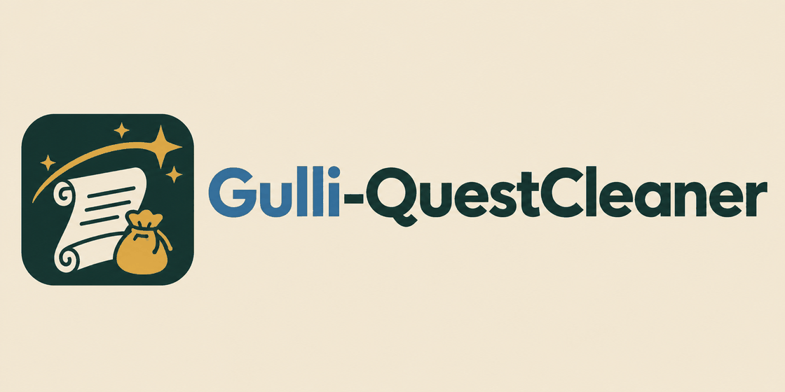
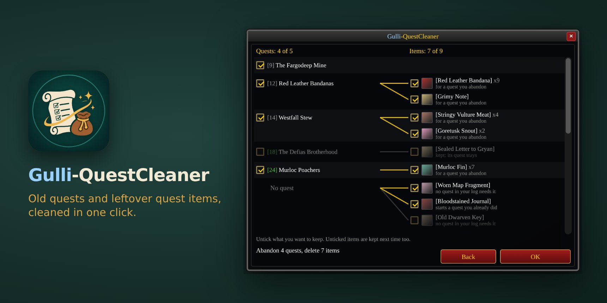
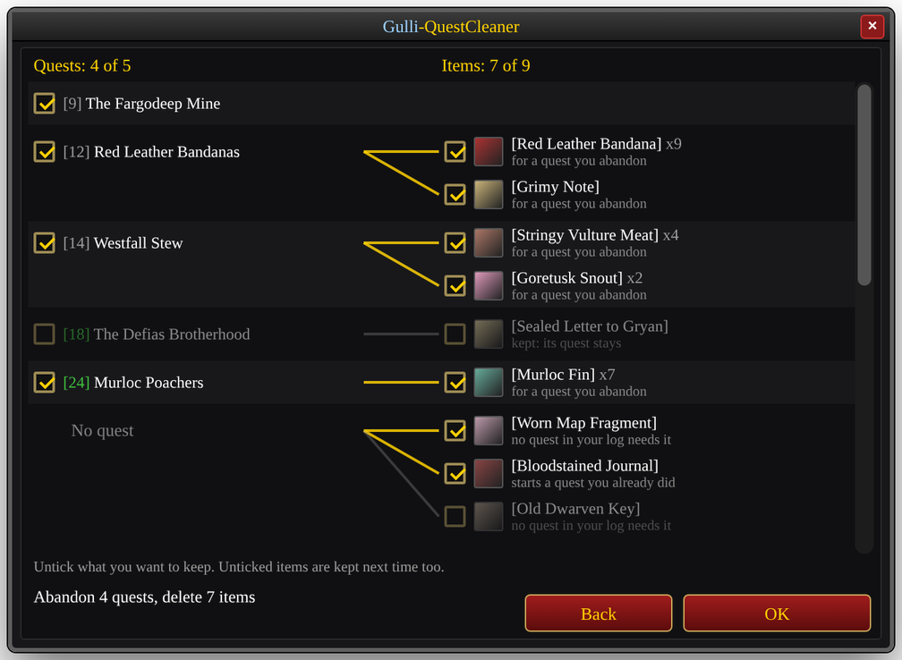
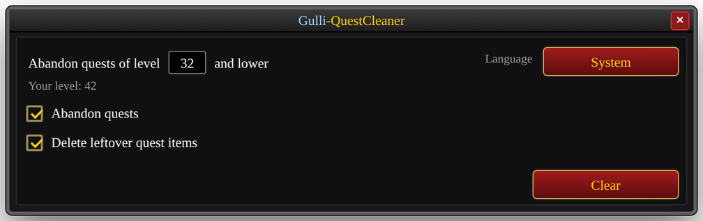

<p align="center">
  <picture>
    <source media="(prefers-color-scheme: dark)" srcset="docs/images/wordmark-dark.png">
    
  </picture>
</p>

<p align="center"><b>A small WoW Forever addon that cleans your quest log and your bags in one click. You see everything before it goes.</b></p>

<p align="center">
  <a href="../../releases/latest"></a>
  
  
</p>

<p align="center"></p>

---

After a few zones, your quest log is full of grey quests, and your bags are full of pelts, letters and notes for quests you will never finish. Gulli-QuestCleaner cleans both. Enter a level, press **Clear**, look at the list, press **OK**.

## Features

- **Old quests out.** Enter a level, and every quest of that level and lower is abandoned.
- **Leftover quest items out.** Pelts for a quest you abandon, notes nobody asks for any more, items that start a quest you already did: they go too.
- **See it before it goes.** Nothing is removed until you press **OK**. The list shows your quests on the left and their items on the right, with a line from each quest to its items. Items no quest needs hang under **No quest**.
- **Sorted by zone.** Quests are grouped by zone, as in your quest log. Tick or untick a whole zone with one click.
- **Keep what you want.** Untick a quest, and its items stay too. Untick an item, and the addon remembers it and does not offer it again.
- **Safe by design.** An item a quest in your log still needs is never offered. Dungeon keys, Drakefire Amulet, Aqual Quintessence and other items that stay useful after their quest are never offered either.
- **Small and quick.** One window, three buttons. Open it with `/gqc` or from the addon button on the minimap.
- **Made for handhelds.** Big buttons and check boxes, so it works with a mouse and with touch on WoW Forever for Android.
- **Clean, modern look.** A flat dark window in your class colour, in the style of ElvUI. It fits a modern interface.
- **Your language.** English, German, Spanish, French, Polish, Portuguese, Russian and Chinese. It follows the language of your game.

<p align="center"></p>

<details>
<summary><b>More pictures</b></summary>

<p align="center"></p>
</details>

## Install

**With [Runeloader](https://github.com/Gulliby-development/runeloader)** (Android): open **Browse**, search for **Gulli-QuestCleaner** and tap **Install**.

**By hand:**

1. **Download** `Gulli-QuestCleaner-<version>-forever.zip` from the [latest release](../../releases/latest).
2. **Unpack** it into the game's `Interface/AddOns` folder. You get the folder `Interface/AddOns/Gulli-QuestCleaner`.
3. **Restart** the game, or type `/reload`.

## How to use it

1. Type `/gqc`, or click the addon button on the minimap.
2. Enter a level. Quests of this level and lower are cleaned.
3. Press **Clear**. The list shows what will go, zone by zone.
4. Untick anything you want to keep: a quest, an item or a whole zone.
5. Press **OK**.

> [!TIP]
> The first time, try it on a character whose quests you do not mind losing. An abandoned quest can be taken again from its quest giver, but a deleted item is gone.

## FAQ

<details>
<summary><b>It says "Press OK again"</b></summary>

The game refused to remove something, for example because the item was busy. The list shows what is left; press **OK** again.
</details>

<details>
<summary><b>An item I need is in the list</b></summary>

Untick it. The addon remembers it and does not offer it again. To forget all items you kept, type `/gqc reset`.
</details>

<details>
<summary><b>Why is my quest item not in the list?</b></summary>

A quest in your log still needs it, or it is one of the items that stay useful after their quest, such as a dungeon key. The addon keeps an item whenever it is not sure.
</details>

<details>
<summary><b>The window is in the wrong language</b></summary>

The addon uses the language of your game client. If your game's language is not one of the eight, it speaks English.
</details>

<details>
<summary><b>Does it work in combat?</b></summary>

No. Leave combat first. The addon never removes anything during a fight.
</details>

## For developers

<details>
<summary><b>What counts as a leftover quest item</b></summary>

- A bag item is a quest item when its class is Quest, the game marks it as a quest item, or it starts a quest.
- It is offered when no quest that stays in your log needs it: its name is not in that quest's objectives, summary or description, and it is not the quest's usable item.
- An item that starts a quest is offered only when that quest is already done.
- Items in the built-in list of lasting items (keys, attunements, raid summoning items) and items you unticked before are never offered.
</details>

<details>
<summary><b>Releases and Runeloader</b></summary>

Each release has `Gulli-QuestCleaner-<version>-forever.zip` and a `release.json` with the `forever` flavor. The [Runeloader index](https://github.com/Gulliby-development/runeloader-index) reads them every night, and Runeloader installs and updates the addon from them.

To make a release, bump `## Version` in the TOC and run the **Release** workflow from the Actions tab.
</details>

<details>
<summary><b>Tests</b></summary>

The tests run the addon on a small fake WoW client:

```sh
lua5.1 tests/test.lua
```

[AGENTS.md](AGENTS.md) has the code map, the development workflow and the checks to run.
</details>

---

<p align="center">
  <br>
  <sub>Gulli-QuestCleaner is a fan project. It is not affiliated with Blizzard Entertainment.</sub>
</p>
